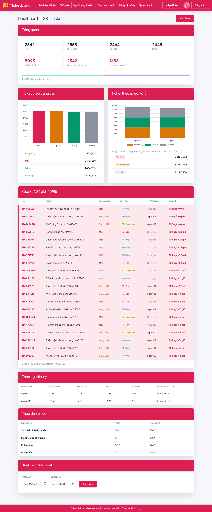
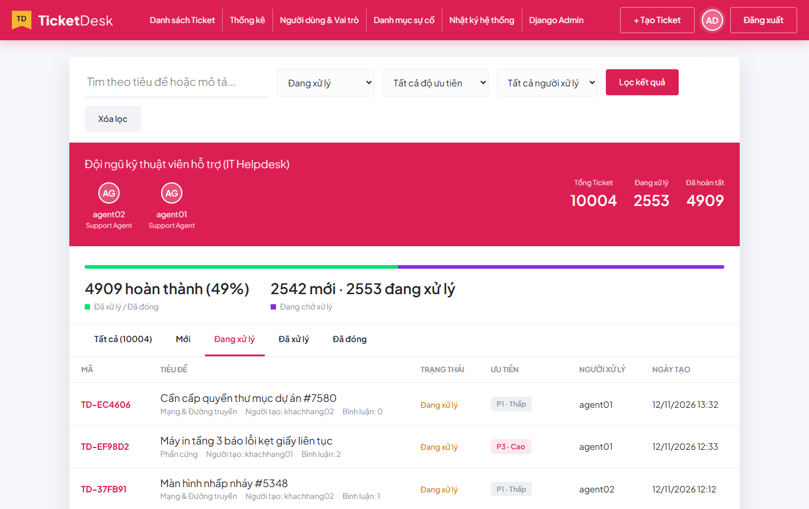
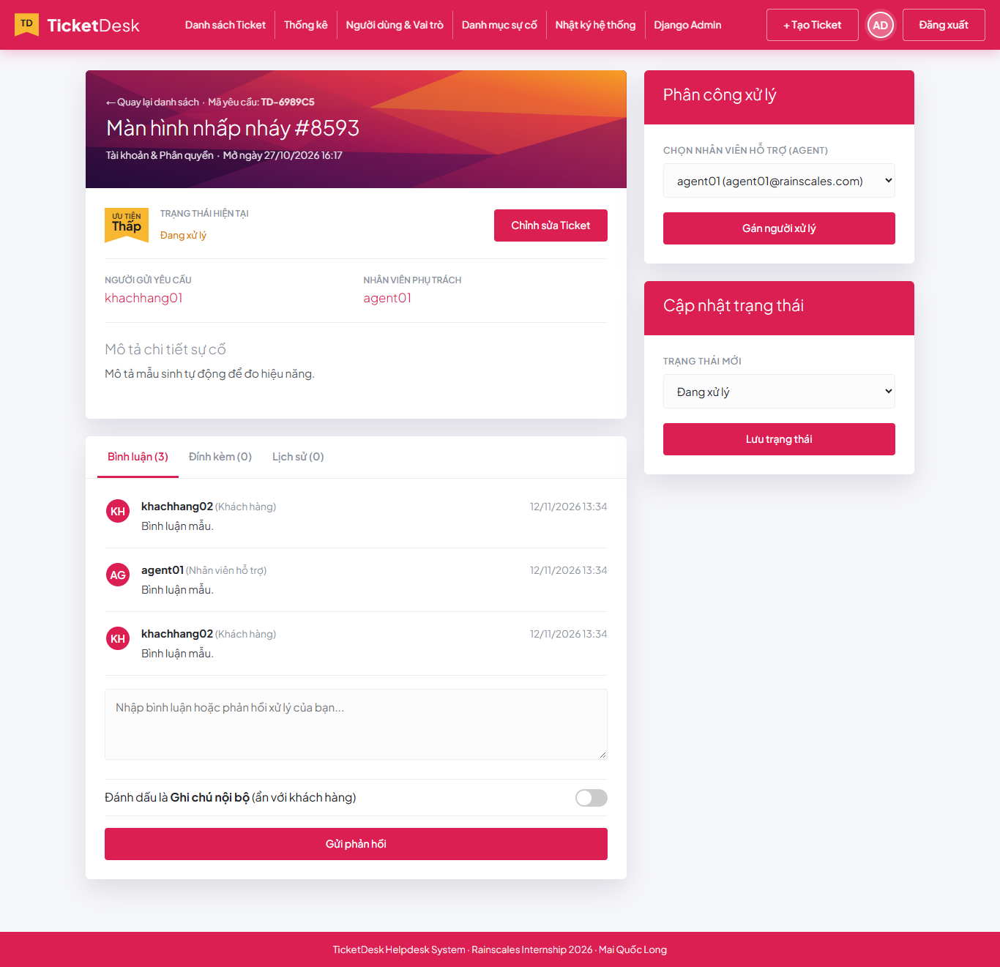
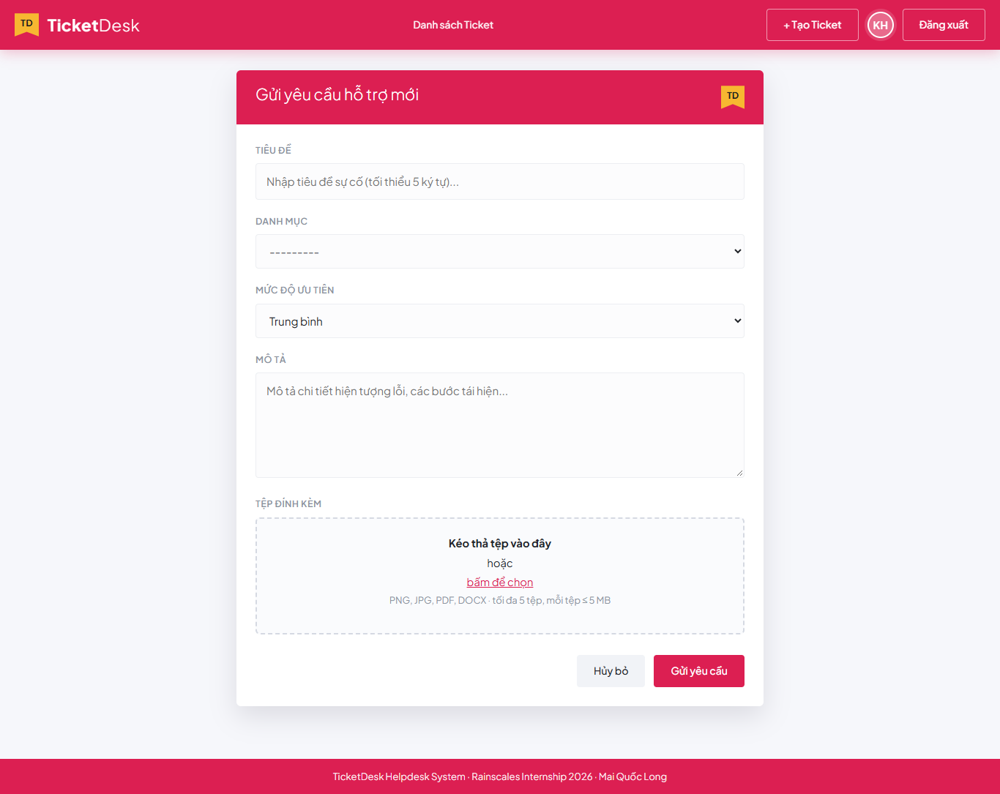
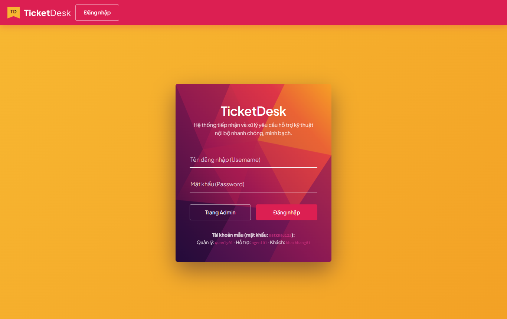

# TicketDesk — Hệ thống tiếp nhận và xử lý yêu cầu hỗ trợ nội bộ

TicketDesk là một ứng dụng web giúp nhân viên trong công ty gửi yêu cầu hỗ trợ IT (máy hỏng, mất mạng, cần cấp quyền...) và giúp bộ phận IT theo dõi, phân công, xử lý các yêu cầu đó ở một nơi, thay cho email và tin nhắn rời rạc.




## Tính năng chính

- **Gửi yêu cầu hỗ trợ** kèm ảnh hoặc tài liệu (kéo thả tệp), chọn danh mục và mức độ ưu tiên.
- **Phân quyền theo 3 vai trò**: Khách hàng chỉ thấy yêu cầu của mình; Nhân viên hỗ trợ xử lý và đổi trạng thái; Quản lý phân công, quản lý người dùng và xem thống kê.
- **Theo dõi tiến độ**: bình luận, ghi chú nội bộ chỉ đội IT thấy, lịch sử mọi thay đổi; thao tác cập nhật ngay không cần tải lại trang.
- **Dashboard cho Quản lý**: biểu đồ theo trạng thái và theo nhân viên, danh sách yêu cầu quá hạn 24 giờ được tô đỏ, xuất báo cáo Excel.
- **Thông báo tự động**: email khi yêu cầu đổi trạng thái hoặc có bình luận mới, email nhắc việc quá hạn mỗi sáng, webhook gửi sang hệ thống khác.
- **REST API** cho ứng dụng khác kết nối, có tài liệu Swagger để thử trực tiếp.

## Ảnh màn hình

| Danh sách yêu cầu | Chi tiết yêu cầu |
|---|---|
|  |  |
| **Gửi yêu cầu mới** | **Đăng nhập** |
|  |  |

Giao diện dùng được trên điện thoại: xem ảnh bản điện thoại trong [docs/frontend_week9.md](docs/frontend_week9.md).

## Vai trò của tôi

Dự án cá nhân trong chương trình thực tập Full-stack Python/Django tại **Công ty TNHH Rainscales Việt Nam** (2026). Tôi tự làm toàn bộ: phân tích yêu cầu, thiết kế cơ sở dữ liệu và giao diện, backend, REST API, tác vụ nền, giao diện web và kiểm thử.

- **Thực hiện:** Mai Quốc Long

## Số liệu

| | |
|---|---|
| Kiểm thử tự động | 339 test, tất cả đều đạt |
| Độ phủ mã (coverage) | 98% |
| REST API | 32 thao tác trên 21 đường dẫn (`/api/v1/`) |
| Dữ liệu thử hiệu năng | 10.004 ticket, 15.020 bình luận; trang danh sách chạy 7 truy vấn mỗi lần tải, không tăng theo số ticket |
| Kiểm tra chất lượng | Ruff (lint + format) và mypy chạy tự động trước mỗi commit |

---

## Phần kỹ thuật

### Công nghệ

| Lớp | Công nghệ |
|---|---|
| Backend | Python 3.12+, Django 5.2, Django REST Framework, SimpleJWT, django-filter |
| Cơ sở dữ liệu | PostgreSQL 16 |
| Tác vụ nền, cache | Celery, Redis 7 (Celery Beat cho việc định kỳ) |
| Giao diện | Django Template, Bootstrap 5.3, HTMX 2, Chart.js 4 |
| Tài liệu API | drf-spectacular (Swagger UI), bộ request Bruno/Postman |
| Kiểm thử, chất lượng | pytest, pytest-django, pytest-cov, factory-boy, Ruff, mypy + django-stubs, pre-commit |
| Môi trường | uv, Docker Compose (PostgreSQL, Redis, Mailpit) |

### Cài đặt và chạy

Cần có: Python 3.12+, [uv](https://docs.astral.sh/uv/), Docker Desktop.

```bash
docker compose up -d --wait            # PostgreSQL, Redis, Mailpit
cp .env.example .env
uv sync
uv run python manage.py migrate
uv run python manage.py seed_demo      # tài khoản + danh mục + ticket mẫu
uv run python manage.py runserver      # http://127.0.0.1:8000
```

Tác vụ nền (email, xuất Excel, nhắc quá hạn, webhook), mỗi lệnh một terminal:

```bash
uv run celery -A config worker -l info --pool=solo   # Windows cần --pool=solo
uv run celery -A config beat -l info
```

Tài khoản demo sau khi chạy `seed_demo`:

| Tài khoản | Mật khẩu | Vai trò |
|---|---|---|
| `admin` | `admin123` | Quản trị (superuser) |
| `quanly01` | `matkhau123` | Quản lý |
| `agent01`, `agent02` | `matkhau123` | Nhân viên hỗ trợ |
| `khachhang01`, `khachhang02` | `matkhau123` | Khách hàng |

Địa chỉ hữu ích:

- Swagger UI: http://127.0.0.1:8000/api/docs/
- Trang quản trị: http://127.0.0.1:8000/admin/
- Hộp thư thử (Mailpit): http://localhost:8025
- Vào psql: `docker exec -it ticketdesk-db psql -U ticketdesk`

Tạo nhiều dữ liệu để đo hiệu năng: `uv run python manage.py seed_tickets --count 10000`.

Gửi email thật qua Gmail và cấu hình webhook: xem [docs/background_tasks_week8.md](docs/background_tasks_week8.md) mục 4.1 và mục 12.

### Kiểm thử và kiểm tra chất lượng

```bash
uv run pytest --cov=apps --cov-report=term-missing
uv run ruff check .
uv run ruff format --check .
uv run mypy .
```

Hook pre-commit chạy Ruff và mypy trước mỗi commit (`uv run pre-commit install`).

### Cấu trúc thư mục

```
ticketdesk/
├── apps/
│   ├── accounts/     # User (3 vai trò), đăng nhập web, API JWT
│   └── tickets/      # Ticket, bình luận, đính kèm, lịch sử; services, selectors,
│                     # tasks (Celery), reports (Excel), api/ (DRF), tests/
├── config/           # settings (base/dev/test/prod), urls, celery, logging
├── templates/        # base, partials, màn hình tickets
├── static/           # css/style.css, js/ (đính kèm, dashboard, xuất Excel)
├── docs/             # tài liệu thiết kế và báo cáo từng tuần
├── docker-compose.yml
└── sales.py          # bài tập CLI tuần 1 (test ở tests/test_sales.py)
```

### Tài liệu

| Tài liệu | Nội dung |
|---|---|
| [requirements_v1.md](docs/requirements_v1.md) | User story và tiêu chí nghiệm thu |
| [erd_v1.dbml](docs/erd_v1.dbml), [adr/](docs/adr/) | Thiết kế cơ sở dữ liệu, quyết định kiến trúc |
| [wireframes.md](docs/wireframes.md) | Wireframe 5 màn hình |
| [api_spec.md](docs/api_spec.md), [api_collection/](docs/api_collection/) | Đặc tả API, bộ request Bruno/Postman |
| [perf_week5.md](docs/perf_week5.md) | Tối ưu truy vấn, số liệu trước/sau |
| [test_week7.md](docs/test_week7.md) | Chiến lược kiểm thử, coverage |
| [background_tasks_week8.md](docs/background_tasks_week8.md) | Celery, email, nhắc SLA, xuất Excel, cache, logging, webhook |
| [frontend_week9.md](docs/frontend_week9.md) | Giao diện, HTMX, kiểm tra responsive |
