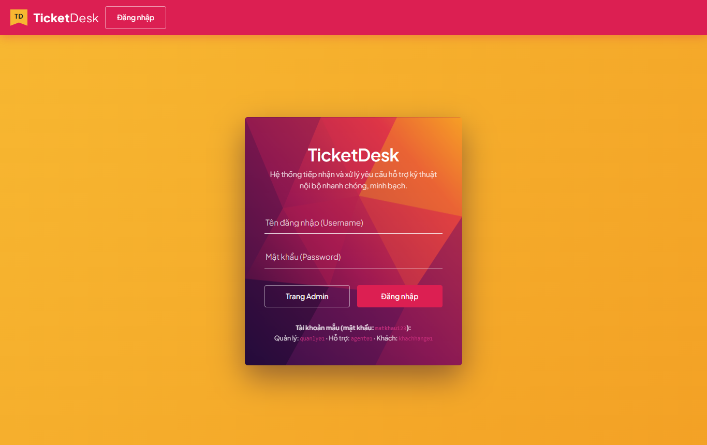
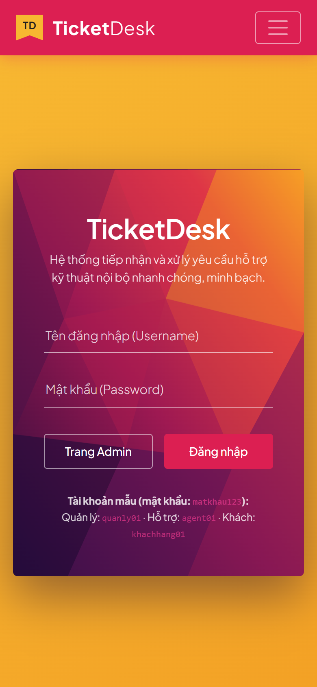
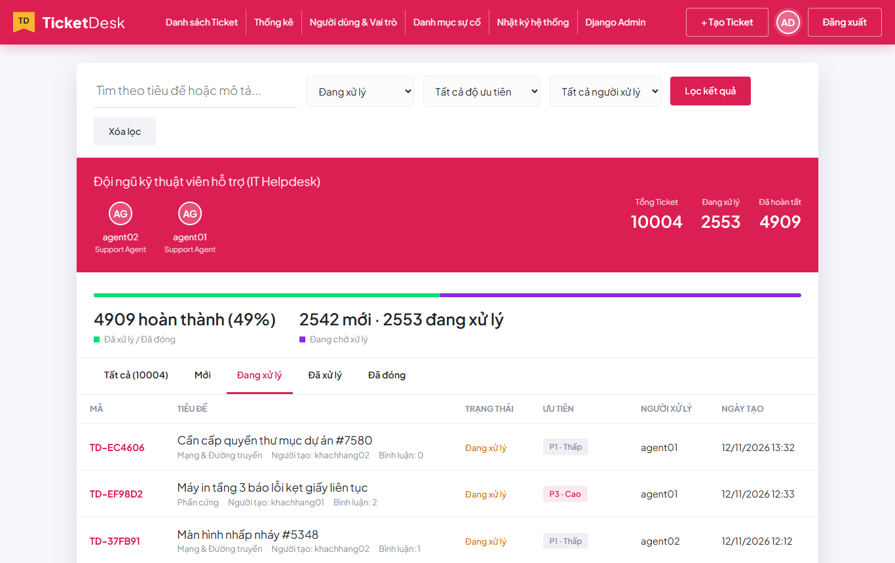
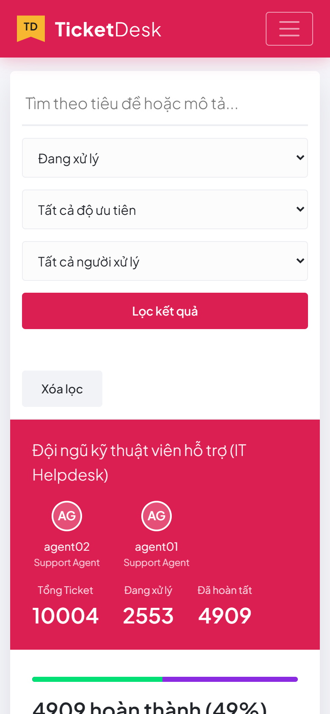
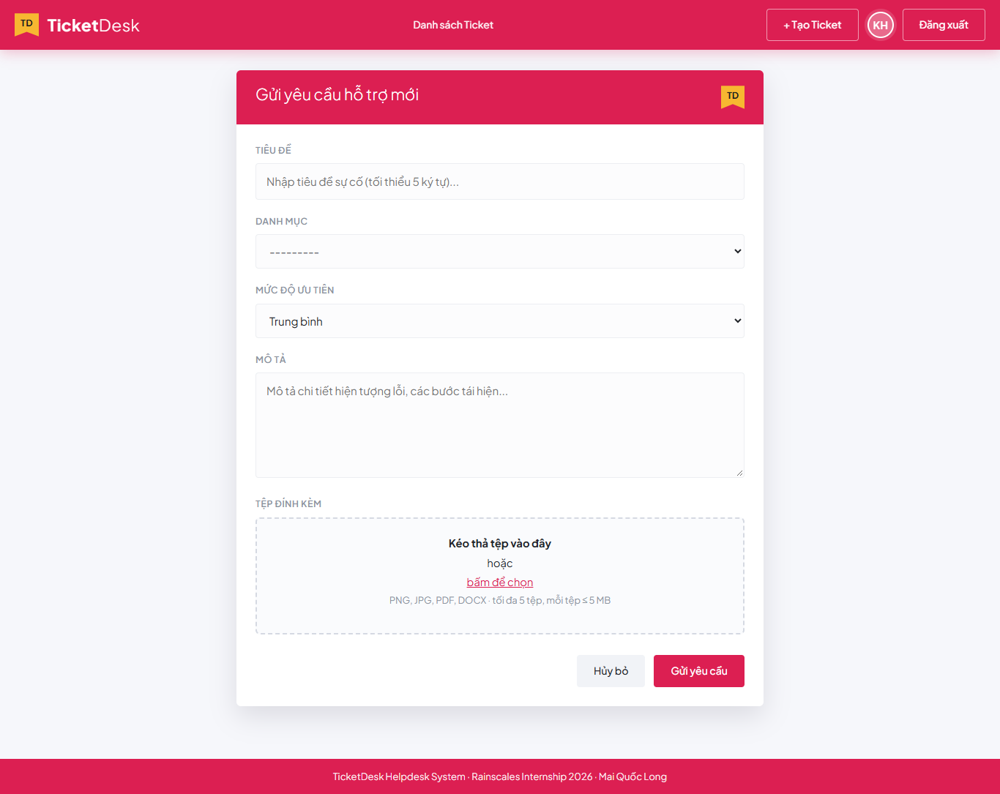
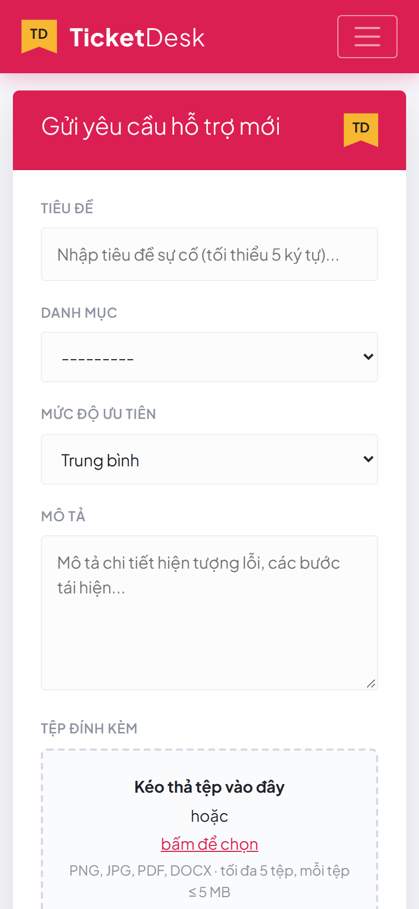
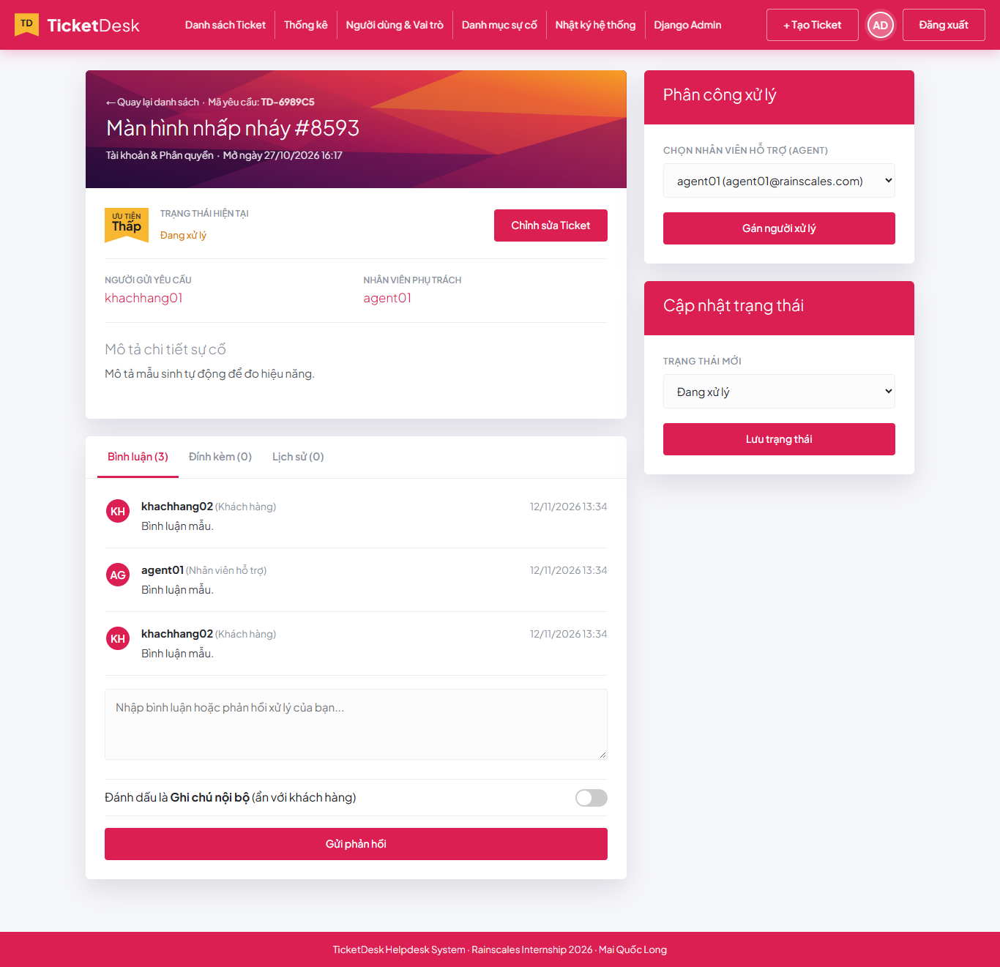
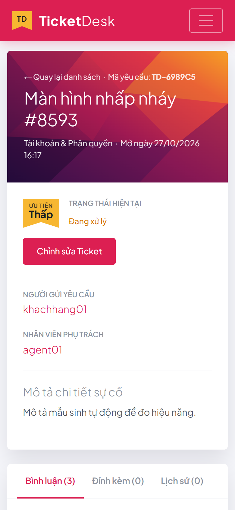
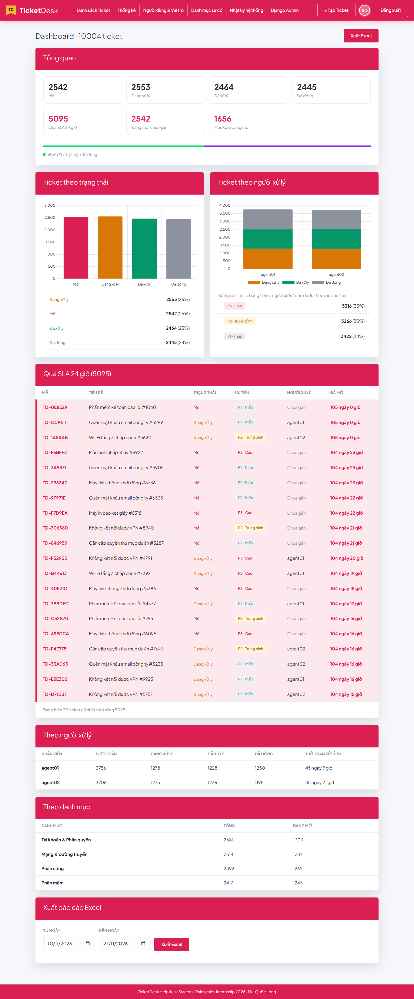
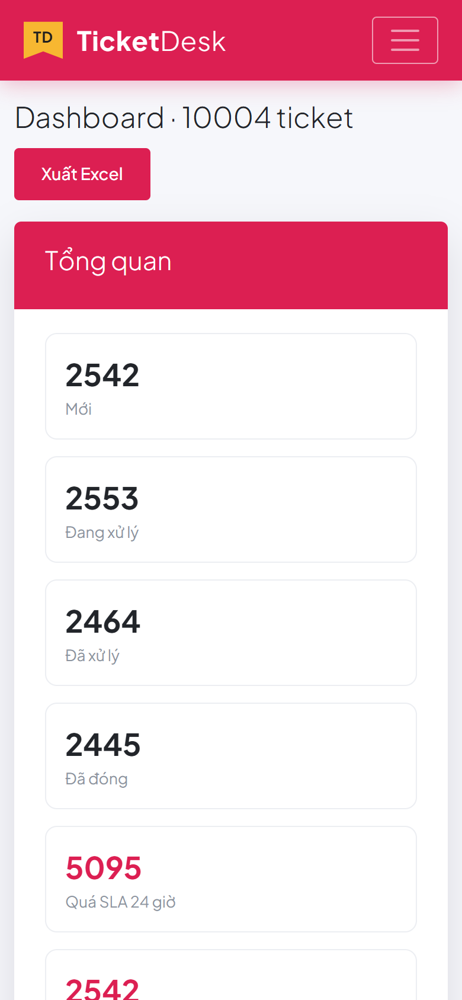

# Tuần 9 — Frontend căn bản

Giao diện web của TicketDesk dùng Django Template, Bootstrap 5.3 và HTMX 2. Mục tiêu tuần 9 là làm đủ 5 màn hình theo [wireframe tuần 3](wireframes.md), chạy được trên desktop và điện thoại, và thao tác không cần tải lại trang ở những chỗ người dùng làm nhiều nhất.

## 1. Thư viện phía trình duyệt

| Thư viện | Phiên bản | Nạp ở | Dùng cho |
|---|---|---|---|
| Bootstrap | 5.3.3 (CDN jsDelivr) | `templates/base.html` | Lưới, navbar thu gọn, tab, alert. Biến `--bs-*` được gán sang bảng màu `--mv-*` trong `static/css/style.css` |
| HTMX | 2.0.4 (CDN unpkg) | `templates/base.html` | Lọc danh sách, phân trang, gán / đổi trạng thái / bình luận không tải lại trang |
| Chart.js | 4.4.7 (CDN jsDelivr) | `templates/tickets/manage_stats.html` | 2 biểu đồ cột ở Dashboard |

JavaScript tự viết (không framework):

| File | Việc |
|---|---|
| `static/js/attachments.js` | Vùng kéo thả tệp ở form tạo ticket; kiểm tra đuôi tệp, 5 MB, tối đa 5 tệp ở phía trình duyệt. Server vẫn kiểm tra lại (`apps/tickets/validators.py`) |
| `static/js/dashboard.js` | Vẽ biểu đồ từ dữ liệu `json_script` |
| `static/js/export.js` | Nút "Xuất Excel": gửi `fetch` tới API export tuần 8, hỏi trạng thái mỗi 1,5 giây rồi hiện link tải |

CSRF: `base.html` đặt `hx-headers='{"X-CSRFToken": ...}'` trên `<body>`, nên mọi request HTMX đều có token. `export.js` tự gửi header `X-CSRFToken`.

## 2. Năm màn hình và wireframe

Ảnh chụp ở `docs/images/` (desktop 1366 px, điện thoại 390 px), dữ liệu demo 10.004 ticket.

| # | Màn hình | URL | Wireframe yêu cầu | Đã làm |
|---|---|---|---|---|
| 1 | Đăng nhập | `/accounts/login/` | Ô tài khoản, mật khẩu, thông báo lỗi, chuyển hướng theo vai trò | `RoleLoginView`: Manager/staff vào Thống kê, Agent/Customer vào Danh sách; `next` trỏ ra domain ngoài bị bỏ qua; sai mật khẩu giữ lại tên đăng nhập, lỗi có `role="alert"` |
| 2 | Danh sách ticket | `/` | Lọc trạng thái, ưu tiên, người xử lý, ô tìm, bảng, phân trang | Bảng 6 cột trong `tickets/_table.html`; lọc người xử lý chỉ hiện cho Agent/Manager (có "Chưa gán"); phân trang giữ bộ lọc bằng ``; nút "Xóa lọc" |
| 3 | Tạo ticket | `/new/` | Tiêu đề, danh mục, ưu tiên, mô tả, kéo thả đính kèm, nút Gửi | `TicketCreateForm`; ticket và tệp lưu trong một transaction, tệp sai thì không tạo ticket |
| 4 | Chi tiết ticket | `/<id>/` | Khối Gán / Đổi trạng thái theo quyền; tab Bình luận, Đính kèm, Lịch sử | Customer không thấy khối thao tác; Agent chỉ đổi trạng thái; Manager có cả Gán. Ô "Ghi chú nội bộ" chỉ hiện cho Agent/Manager; tải tệp qua view có kiểm tra quyền |
| 5 | Dashboard | `/manage/stats/` | Thẻ số liệu, biểu đồ theo trạng thái và người xử lý, danh sách "Quá SLA" tô đỏ, nút Xuất Excel | Thẻ số liệu bằng CSS Grid `auto-fit minmax(220px, 1fr)`; 2 biểu đồ cùng màu với nhãn trạng thái; 20 ticket quá SLA cũ nhất; form chọn khoảng ngày để xuất |

| Màn hình | Desktop | Điện thoại |
|---|---|---|
| Đăng nhập |  |  |
| Danh sách |  |  |
| Tạo ticket |  |  |
| Chi tiết |  |  |
| Dashboard |  |  |

## 3. HTMX dùng ở đâu

| Chỗ dùng | Thuộc tính | Server trả về |
|---|---|---|
| Lọc / tìm ở Danh sách | `hx-get`, `hx-trigger="input changed delay:300ms from:#f-q, change from:.mv-filter-select, submit"`, `hx-target="#ticket-table"`, `hx-push-url` | `TicketListView` thấy header `HX-Request` thì chỉ render `_table.html` (kèm nút "Xóa lọc" bằng `hx-swap-oob`). Header `HX-History-Restore-Request` thì trả cả trang. Có `Vary: HX-Request` để cache không lẫn |
| Phân trang | `hx-get` + `hx-push-url` trên nút Trước/Tiếp | Như trên |
| Gán, đổi trạng thái, bình luận | `hx-post`, `hx-swap="none"`, `hx-disabled-elt="find button"` | `_ticket_update.html`: các khối tóm tắt, thao tác, bình luận, đính kèm, lịch sử, số đếm tab và thông báo, mỗi khối có `hx-swap-oob` |
| Hết phiên đăng nhập khi đang dùng HTMX | | Trả 204 + `HX-Redirect` tới trang đăng nhập (kèm `next`), tránh nhét trang đăng nhập vào giữa bảng |

Không có JavaScript thì các form vẫn chạy: lọc là GET thường, thao tác là POST rồi redirect.

## 4. Kiểm tra responsive

- Navbar thu thành nút ☰ khi màn hình dưới 1200 px. Từ 1200 đến 1800 px navbar dùng chữ và khoảng cách nhỏ hơn, ẩn tên người dùng (vẫn còn avatar, rê chuột hiện tên và vai trò).
- Bảng danh sách nằm trong `table-responsive`; các thẻ số liệu tự xuống hàng nhờ `auto-fit`.
- Kiểm tra tự động bằng Playwright + Chrome: 7 trang (Danh sách, Tạo, Chi tiết, Thống kê, Người dùng, Danh mục, Nhật ký) ở 10 độ rộng 360, 768, 1199, 1200, 1280, 1366, 1440, 1599, 1600, 1920 px, đo `document.documentElement.scrollWidth` không vượt độ rộng cửa sổ, nghĩa là không có thanh cuộn ngang.
- Lỗi tìm ra khi kiểm tra và đã sửa:
  - Navbar của Manager (6 mục) tràn ngang ở 1200–1800 px: trang rộng 1708 px ở màn 1366 px, nút "Đăng xuất" ra ngoài màn hình.
  - Trang Người dùng tràn 33 px ở 360 px: cột `1fr` của lưới `.mv-detail-grid` không co nhỏ hơn nội dung; thêm `min-width: 0` cho ô con, cho hàng điều khiển xuống dòng.
  - Cột "Đã mở" ở danh sách Quá SLA hiện tiếng Anh ("3 months, 1 week") vì bản dịch tiếng Việt của filter `timesince` không đủ; thay bằng filter `open_age` ("105 ngày 0 giờ").
- Chưa thử trên điện thoại thật; ảnh điện thoại chụp bằng chế độ giả lập thiết bị của Chrome (390 × 844, tỉ lệ điểm ảnh 2).

## 5. Webhook

Webhook khi ticket đổi trạng thái (làm ở tuần 9 để trả nợ tuần 8) được mô tả ở [background_tasks_week8.md, mục 12](background_tasks_week8.md#12-webhook-khi-ticket-đổi-trạng-thái-bổ-sung-tuần-9).

## 6. Kiểm thử

| File | Nội dung |
|---|---|
| `test_ticket_tags.py` | Badge trạng thái / ưu tiên, chống XSS, `open_age` |
| `test_week9_screens.py` | Đăng nhập theo vai trò, `next` an toàn, thanh lọc, bảng |
| `test_week9_htmx.py` | Partial khi có `HX-Request`, `Vary`, phân trang, hết phiên |
| `test_week9_create_detail.py` | Tạo ticket kèm tệp, kiểm tra tệp, tab, tải tệp có kiểm tra quyền |
| `test_week9_htmx_actions.py` | Gán / đổi trạng thái / bình luận qua HTMX, khối OOB, lỗi nghiệp vụ, CSRF |
| `test_week9_dashboard.py` | Dữ liệu biểu đồ, danh sách Quá SLA, nút Xuất Excel |
| `test_week9_views.py` | Phân quyền trang quản lý, nút theo vai trò, sửa ticket, quản lý người dùng / danh mục, nhật ký |
| `test_webhook.py` | Webhook: ký, tắt, gửi trùng, thử lại |

Chạy: `uv run pytest --cov=apps --cov-report=term-missing`.
